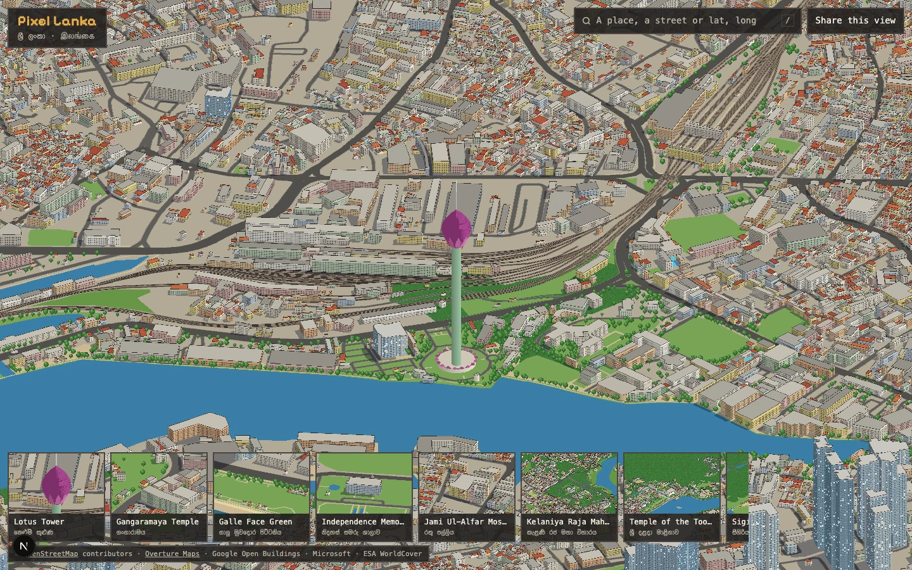

# Pixel Lanka

**All of Sri Lanka as one explorable isometric pixel-art map**, built from open map data. Colombo is drawn in full detail, and you can pan, zoom and search the whole island and jump to its landmarks.

<p align="center">
  
  
</p>

[](https://github.com/Le-Cucks/pixel-lanka/actions/workflows/ci.yml)
[](LICENSE)
[](#data-and-licensing)

## Features

- **The whole island**: about 8.9 million buildings, roads, rivers, tanks, forests and paddy fields, drawn at 0.5 px per metre.
- **City detail layers**: Colombo is drawn at 2 px per metre and stacked exactly on top of the island map. Adding more cities is a one-line change.
- **Landmark cards**: 19 curated landmarks, from Sigiriya to Nallur, with names in English, Sinhala and Tamil, a short description and a thumbnail drawn from the map itself.
- **Search**: about 95,000 places, streets and buildings. Common alternative names work too ("Adam's Peak", "Temple of the Tooth"), and you can type a `lat, long`.
- **Shareable views**: the URL always holds your position and zoom (`?at=lat,lon,zoom`).
- **Fast anywhere**: a deep-zoom tile pyramid means visitors only download what's on screen, typically 2–5 MB per session.

## How it works

```
Overture Maps (OSM + Google + Microsoft buildings, places, land cover)
        │  pipeline/fetch_overture.py     DuckDB reads only the Sri Lanka bbox from S3
        ▼
data/<area>/*.parquet ──► data/<area>/index.duckdb   R-tree spatial index
        │  pipeline/tiles.py               parallel workers render 2048–4096 px regions
        ▼
site/public/tiles/<map>/…  Deep Zoom (DZI) pyramid of lossless WebP tiles
                 world.json   shared projection + where each map sits
        │  site/ (Next.js + OpenSeadragon)
        ▼
the browser stacks the island base + city overlays and converts lat/long ↔ pixels
```

All maps share one projection frame (the Sri Lanka bounding box). That makes a city map an exact, scaled sub-rectangle of the island map, so the site can lay it on top without any seams. Blank sea tiles are stored once and hard-linked, which keeps the whole island at about 1.8 GB.

## Repository layout

```
pipeline/            Python: data download and map rendering
  fetch_overture.py  download Overture layers for an area (AREAS) into data/<area>/
  render.py          projection, palette, and how ground, roads, buildings and trees are drawn
  tiles.py           render a map (MAPS) into a tile pyramid; --fade-only re-fades the edges
  landmarks.py       curated landmarks → landmarks.json + thumbnails
site/                Next.js 16 web app (App Router, TypeScript, OpenSeadragon)
  components/        MapViewer, Search, Landmarks
  lib/geo.ts         lat/long ↔ image pixels; must mirror pipeline/render.py
tests/               pytest unit tests for projection, overlay alignment and fade
docs/images/         screenshots
```

Generated and git-ignored: `data/` (about 2.4 GB of map data and indexes) and `site/public/tiles/` (about 1.9 GB of tiles).

## Getting started

Requirements: [uv](https://docs.astral.sh/uv/) (Python 3.12), Node.js 20.9+, about 6 GB of free disk and an internet connection. The commands below use the Makefile; run `make help` to list them all.

```bash
make setup        # Python + Node dependencies
make data         # download Overture data for Sri Lanka and Colombo (~15 min, ~2.4 GB)
make tiles        # render island (~30 min) + Colombo overlay (~1 min) + landmark cards
make dev          # http://localhost:3000
```

Rendering uses every CPU core but one or two. Lower that with `WORKERS=4 make tiles`. Times above were measured on a 10-core Apple Silicon Mac.

**Working on the site only?** Tiles are loaded from `NEXT_PUBLIC_TILES_BASE` (default `/tiles`). Point it at an existing tile host instead of rendering locally:

```bash
NEXT_PUBLIC_TILES_BASE=https://tiles.example.com make dev
```

### Common tasks

| Task | How |
|---|---|
| Add a city in full detail | Add its bbox to `AREAS` in `pipeline/fetch_overture.py` and an entry to `MAPS` in `pipeline/tiles.py` (`overlay=True, px=2.0`), then `uv run pipeline/fetch_overture.py <area>` and `uv run pipeline/tiles.py <map>` |
| Add or edit a landmark | Edit `LANDMARKS` in `pipeline/landmarks.py`, then `make landmarks` |
| Change colours or building style | `P` and the `draw_*` functions in `pipeline/render.py`; preview a small area with `uv run pipeline/render.py colombo-fort` (writes `out/colombo-fort.png`) |
| Check everything | `make check` (ruff, pytest, eslint, TypeScript) |

## Deployment

The app is a small static Next.js site (about 260 KB of JS). The tiles are the bulk, and they shouldn't be bundled into the app deployment:

1. Upload `site/public/tiles/` to object storage with a CDN, for example Cloudflare R2. Because blank tiles are hard-linked, upload with a tool that follows links (e.g. `rclone copy`). Serve `.webp` as `image/webp` with long cache headers and allow CORS from your site's origin.
2. Deploy `site/` (Vercel, Cloudflare, or any Node/static host) with `NEXT_PUBLIC_TILES_BASE` set to the tile URL and `NEXT_PUBLIC_SITE_URL` set to the public site URL (used for social preview links).

## Data and licensing

- **Code**: [MIT](LICENSE).
- **Map tiles and derived data**: built from [Overture Maps](https://overturemaps.org), which combines data under several licences. Most importantly, [OpenStreetMap](https://www.openstreetmap.org/copyright) data is under the ODbL. Anyone redistributing the tiles must keep the attribution shown on the map. See [DATA_LICENSE.md](DATA_LICENSE.md) for the per-source breakdown.

## Contributing

Bug reports, landmark suggestions and pull requests are welcome. See [CONTRIBUTING.md](CONTRIBUTING.md).

## Roadmap

- More city detail layers: Kandy, Galle, Jaffna, Negombo, Trincomalee
- Terrain, so Sigiriya, Sri Pada and the hill country stand up
- Better building heights (e.g. Google Open Buildings 2.5D)
- Sponsored landmark highlights
- Public deployment
