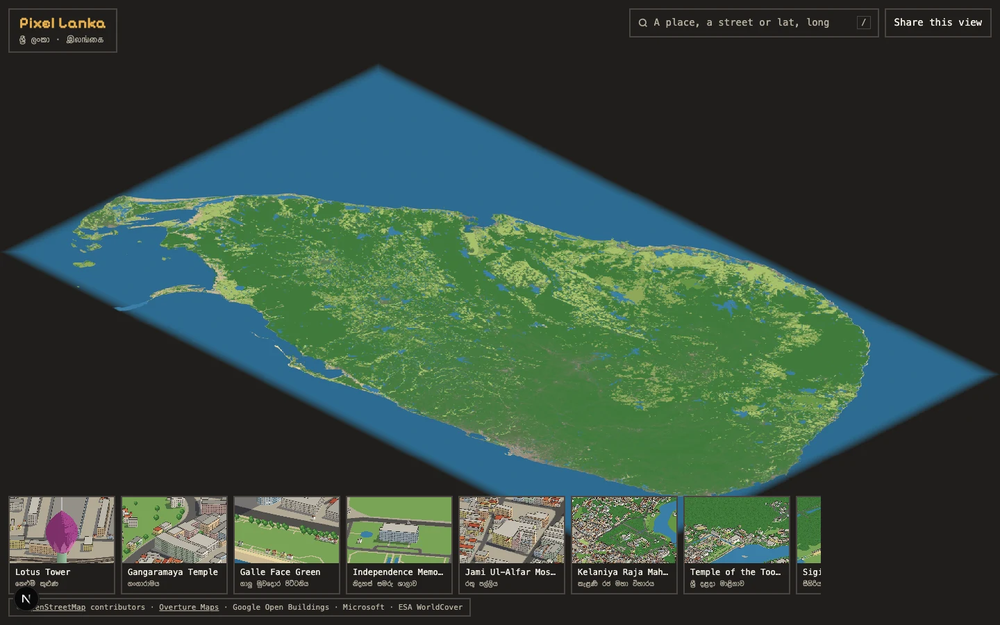

# Pixel Lanka

All of Sri Lanka as one explorable isometric pixel-art map, built from open map data.

**Live: https://le-cucks.github.io/pixel-lanka/**

<p align="center">
  
  
</p>

[](https://github.com/Le-Cucks/pixel-lanka/actions/workflows/deploy.yml)
[](LICENSE)
[](DATA_LICENSE.md)

## Features

- The whole island at 0.5 px/m, with Colombo layered on top at 2 px/m
- 19 landmark cards in English, Sinhala and Tamil
- Search across about 95,000 places, or type `lat, long`
- Shareable views via `?at=lat,lon,zoom`

## Quick start

Needs [uv](https://docs.astral.sh/uv/), Node.js 20.9+ and about 6 GB of disk.

```bash
make setup   # install dependencies
make data    # download Overture data (~2.4 GB)
make tiles   # render the maps (~30 min)
make dev     # http://localhost:3000
make check   # lint and tests
```

## Layout

| Path | What |
|---|---|
| `pipeline/` | Python: download data (`fetch_overture.py`), draw (`render.py`), tile (`tiles.py`), landmarks (`landmarks.py`) |
| `site/` | Next.js + OpenSeadragon viewer |
| `tests/` | Projection and overlay tests |

## Deployment

Pushes to `main` run CI and deploy the static site to GitHub Pages. The tiles (about 1.9 GB) are hosted separately; set the repo variable `TILES_BASE_URL` to their URL.

## License

Code is [MIT](LICENSE). Map data comes from [Overture Maps](https://overturemaps.org) and OpenStreetMap (ODbL); see [DATA_LICENSE.md](DATA_LICENSE.md).

Contributions welcome: see [CONTRIBUTING.md](CONTRIBUTING.md).
